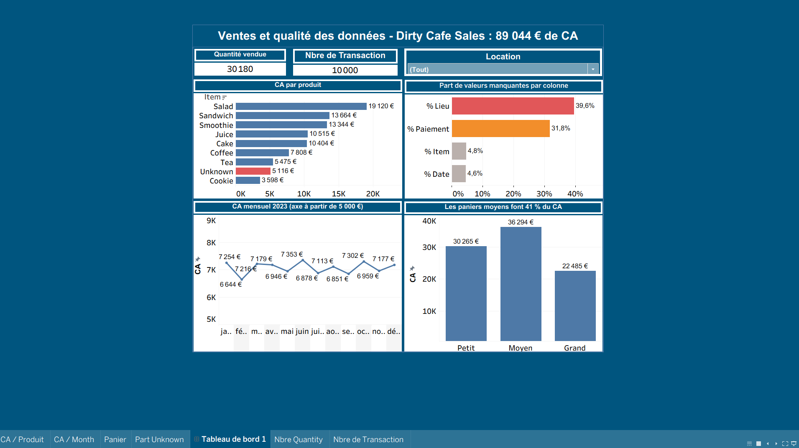

Cafe Dirty Sales

Pipeline de nettoyage, de chargement et d'analyse du dataset Kaggle Dirty Cafe Sales (pandas, PostgreSQL, SQL, Tableau).

Contexte et objectif

Ce dataset vient de Kaggle : il contient 10 000 transactions d'un café, sur 8 colonnes. Il est volontairement sale : valeurs manquantes, valeurs Unknown, types mal formés.

J'ai nettoyé les données avec la bibliothèque Python pandas, puis je les ai chargées dans une base PostgreSQL. Je les ai ensuite analysées en SQL et visualisées dans Tableau.

L'objectif est de montrer une chaîne complète, de la donnée brute jusqu'aux indicateurs, avec des contrôles à chaque étape (nombre de lignes, valeurs manquantes, totaux identiques entre pandas, SQL et Tableau).

Le pipeline

CSV brut → nettoyage pandas → CSV propre → SQLAlchemy → PostgreSQL → analyse SQL → Tableau

Structure du dépôt

Projet/
├── database/
│   ├── 01_dirty_cafe_sales.csv            # données brutes (Kaggle)
│   └── 02_dirty_cafe_clean_go_sql.csv     # données nettoyées
└── Scripts/
    ├── python/file_clean/
    │   ├── 01_dirty_cafe_sales.py
    │   ├── preparation_des_donnees_for_insert.py
    │   └── 02_chef_orchestre.py
    └── sql/file_sql/
        ├── 01_create_table_cafe_dirty_sales.sql
        └── Scripts-Analyse.sql

Décisions de nettoyage

460 tickets sans date (4,6 %) : conservés dans la base, mais exclus des analyses par date (regroupés dans un groupe « sans date » quand c'est utile).

Valeurs manquantes numériques : 27 montants (total_spent), 23 quantités et 10 prix unitaires. Elles restent à NULL plutôt que d'être remplacées par 0, pour ne pas fausser les moyennes.

Unknown conservé tel quel : 4,8 % des produits, 31,8 % des modes de paiement et 39,6 % des lieux. Je les ai gardés plutôt que supprimés, pour ne pas perdre les montants associés, et je les exclus au cas par cas dans les analyses.

1 ligne corrigée à la main : un ticket avait un produit Unknown pour un total de 25. Or 25 = 5 × 5, et les 268 autres tickets à 25 sont tous des Salad. Je l'ai donc corrigé en Salad (quantité 5, prix unitaire 5), avec une requête UPDATE SQL.

Résultats clés

Chiffre d'affaires total : 89 044. Le même total ressort de pandas, de SQL et de Tableau.
Salad est le produit n°1 en CA (19 120), suivi de Sandwich (13 664) et Smoothie (13 344). Coffee est le premier en quantités vendues.

Les paniers moyens font la plus grande part du CA : 40,8 %, alors que les petits paniers (moins de 10) représentent 61,7 % des tickets mais seulement 34,0 % du CA.

Ticket moyen de 8,93, médiane de 8. Les trois modes de paiement connus sont presque à égalité (environ un tiers chacun).
Meilleur mois : juin 2023 (7 353). Mois le plus faible : février 2023 (6 644), mais février n'a que 28 jours : ramené au jour, il vend plus que mai ou juillet.

Le CA est stable sur la semaine (6 % d'écart entre le meilleur et le moins bon jour), et le panier moyen est similaire entre Takeaway et In-store (environ 9 €).

Comment relancer

Installer les dépendances : pip install -r requirements.txt.
Dans PostgreSQL, exécuter Scripts/sql/file_sql/01_create_table_cafe_dirty_sales.sql pour créer le schéma cafe et la table.

Lancer Scripts/python/file_clean/01_dirty_cafe_sales.py : il produit le CSV propre dans database/.

Si la table contient déjà des données, la vider avant de recharger : TRUNCATE cafe.cafe_dirty RESTART IDENTITY;.

Lancer Scripts/python/file_clean/02_chef_orchestre.py : il demande le mot de passe PostgreSQL (saisie masquée, rien n'est stocké dans le code) et charge les données.

Rejouer la correction de la ligne Salad (requête UPDATE), puis exécuter les requêtes de Scripts-Analyse.sql.

Visualisation

Tableau est connecté directement à la base PostgreSQL. Un premier graphique (CA par produit) reprend les chiffres du SQL à l'identique.

Dashboard Tableau :

# ------------------------------------------------------------
Requirements
pandas
numpy
SQLAlchemy
psycopg2-binary

